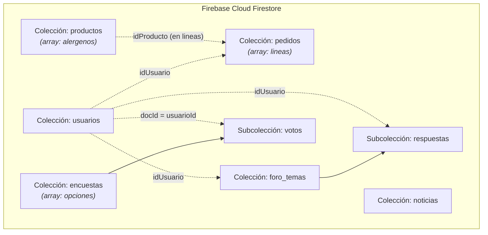

# Esquema NoSQL Cloud Firestore — App Cantina Puig

Este documento describe la estructura y diseño de la base de datos NoSQL basada en documentos para Firebase Cloud Firestore de la App Cantina Puig.

## 🎯 Principios del Diseño NoSQL en Firestore

A diferencia de las bases de datos relacionales tradicionales (como PostgreSQL), Firestore organiza los datos en Colecciones, Documentos y Subcolecciones. Se aplican los siguientes patrones:

* **Desnormalización y Embebido (Embedding):** Datos que se leen conjuntamente (como los productos dentro de un pedido o los alérgenos de un producto) se guardan directamente dentro del documento mediante arrays o mapas, evitando lecturas múltiples.
* **Subcolecciones para relaciones N:M o de crecimiento indeterminado:** Las respuestas del foro y los votos de las encuestas se estructuran como subcolecciones para no superar el límite de 1 MB por documento en Firestore.
* **Control de duplicados mediante ID explícito:** En la subcolección de votos de encuestas, la clave del documento es el `usuarioId`, lo que garantiza mediante el propio motor de la base de datos que un usuario solo puede votar una vez por encuesta.

---

## 📊 Diagrama de Colecciones y Subcolecciones (Mermaid)



---

## 🌲 Estructura Árbol de la Base de Datos

```text
cantina_db/
├── usuarios/ {colección}
│   └── {usuarioId} [documento]
├── productos/ {colección}
│   └── {productoId} [documento]
├── pedidos/ {colección}
│   └── {pedidoId} [documento]
├── noticias/ {colección}
│   └── {noticiaId} [documento]
├── foro_temas/ {colección}
│   └── {temaId} [documento]
│       └── respuestas/ {subcolección}
│           └── {respuestaId} [documento]
└── encuestas/ {colección}
    └── {encuestaId} [documento]
        └── votos/ {subcolección}
            └── {usuarioId} [documento]
```

---

## 📝 Especificación de Colecciones y Documentos (JSON Schema)

### 1. Colección: `usuarios`
**ID del documento:** UID asignado por Firebase Authentication (ej. `usr_987654321`).

```json
{
  "email": "jmperez@elpuig.xeill.net",
  "nombre": "Jose",
  "apellidos": "Pérez",
  "rol": "ALUMNO",
  "estado": "ACTIVO",
  "favoritos": ["prod_boc_01", "prod_caf_02"],
  "fechaRegistro": "2026-11-09T08:30:00Z"
}
```

### 2. Colección: `productos`
**ID del documento:** Auto-generado o slug identificativo (ej. `prod_boc_tortilla`).

```json
{
  "nombre": "Bocadillo de Tortilla de Patatas",
  "descripcion": "Bocadillo vegetal con tortilla recién hecha",
  "precio": 2.50,
  "imagenUrl": "[https://storage.googleapis.com/.../tortilla.jpg](https://storage.googleapis.com/.../tortilla.jpg)",
  "stockDiario": 50,
  "esBocadilloDiaOp1": true,
  "esBocadilloDiaOp2": false,
  "esPremium": false,
  "activo": true,
  "alergenos": ["gluten", "huevo"]
}
```

### 3. Colección: `pedidos`
**ID del documento:** Auto-generado (ej. `ped_20261109_001`).

```json
{
  "idUsuario": "usr_987654321",
  "fechaCreacion": "2026-11-09T08:35:00Z",
  "fechaRecogida": "2026-11-09T11:00:00Z",
  "estado": "PENDIENTE",
  "metodoPago": "BIZUM",
  "total": 4.20,
  "lineas": [
    {
      "idProducto": "prod_boc_tortilla",
      "nombre": "Bocadillo de Tortilla de Patatas",
      "cantidad": 1,
      "precioUnitario": 2.50
    },
    {
      "idProducto": "prod_caf_leche",
      "nombre": "Café con leche",
      "cantidad": 1,
      "precioUnitario": 1.70
    }
  ]
}
```